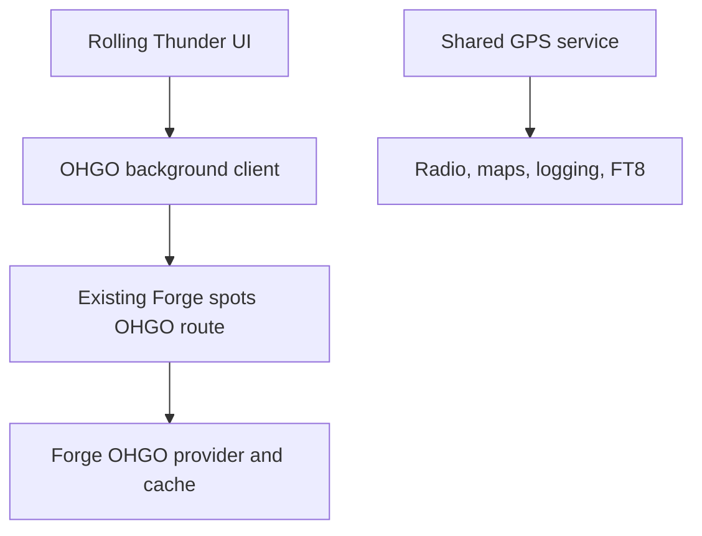

# MC-REMOVE dependency inventory — source removal boundary

**Baseline:** `main` at `91315847e313d6b3f1e1eaad1f5a2b7dee7659e3`.
**Change:** source-only removal; no installed service, production database,
configuration, Forge host, USB device, or network infrastructure is changed.

## Dependency graph after the source change

OHGO shares neither the GPS service nor the removed MeshCore service. Its route,
credential, cache, 120-second upstream limit, and disabled/stale/unavailable
states remain Forge-owned.

## Classification

| Classification | Components | Disposition |
| --- | --- | --- |
| MeshCore-only | USB framing/serial owner, collector CLI, passive decoder/writer/repository, GPS snapshot bridge, broker/config/drain/API, public consumer/intelligence, traffic worker/ledger/geocoding/relevance, Forge MeshCore road-site analysis/import, config gate, package CLI, collector and traffic service/install/acceptance scripts | Remove from active source, application composition, packaging and deployment templates. No generic serial library, general GPS service, spot service, or contact store is removed. |
| OHGO-only | Forge OHGO domain/provider, HTTPS adapter, credential loader, route/background service, Pi cached client, large-text panel, scroll interceptor, `o` shortcut and rendering tests | Preserve. Rename `meshcore_ohgo_panel.py`/`meshcore_ohgo_ui.py` to `ohgo_panel.py`/`ohgo_ui.py`; screen label is `OHGO`. |
| Shared | Existing Forge spots listener/API, `forge_spot_main.py`, `context_navigation.py`, `ui_main.py`, `live_map.GeoPoint`, shared GPS, radio/CAT/PTT, DMR controls, contact/QSO SQLite, logging/sync, weather, spots, map and startup/shutdown owners | Preserve contracts; remove only the MeshCore registrations and GPS snapshot listener. `GeoPoint` now comes from shared `live_map.py`. |
| Historical evidence | Prior MeshCore engineering designs, incidents, tests recorded in Git history, dated operator hardware observations, and `research/meshcore_passive/` | Retain. Mark old descriptions as historical; do not reintroduce them into runtime indexes. |
| Production-only, separately gated | Enabled user-level `meshcore-collector.service` and `meshcore-traffic-worker.service`, broker config/credential files, active collector/broker/traffic databases and queue state | Preserve untouched pending separately approved cutover. Follow-up read-only evidence identifies both unit states and verifies active database integrity; it does not authorize stop/disable, uninstall, migration, or deletion. |

## Follow-up installed-state evidence (2026-11-15)

This is read-only production evidence, not part of the source change. See the
REL-01 installed-state snapshot for the full host, device, and QSO evidence.

- `meshcore-collector.service` is an enabled, active user unit under
  `/home/geoff/.config/systemd/user`, with broker activation in drop-in
  `10-message-broker.conf`. Its process is PID 1078, outside
  `/system.slice/rolling-thunder.service`.
- The unit's configured `/dev/serial/by-path/...usb-0:1.1.1:1.0` link is absent
  from the current serial inventory. PID 1078 has no open serial descriptor;
  recent logs repeat that the receiver path is not present. The service remains
  active and retries every five seconds. No action was taken.
- `meshcore-traffic-worker.service` is enabled but inactive/dead. The user
  system manager recorded an ordering cycle involving the worker,
  `meshcore-collector.service`, and `default.target` on 2026-07-23. No action
  was taken.
- The collector observation DB reports schema 2, 568 observations, 236 nodes,
  and 4,074 signal samples. The broker DB has 236 messages (228 public and 8
  quarantined); its public cursor is at 199, with 34 public records beyond that
  cursor. The traffic ledger has 194 records, all `ignored`. SQLite
  `integrity_check` passed and foreign-key checks returned zero violations for
  the observation, broker, and traffic DBs. No message payloads were read and
  no database or sidecar was copied.

The source PR intentionally does not stop or uninstall these units. A later
production package must not be installed until the owner separately approves a
parked cutover through the actual user-level systemd supervisor, queue/consumer
disposition, and preservation of all observation, broker, and traffic history.

## Active source and runtime removal inventory

The change removes all `src/rolling_thunder/meshcore_*.py` modules and
`src/rolling_thunder/forge_meshcore_*.py` modules. The removed responsibilities
cover:

- collector composition, serial ownership, frame decoder, observation writer,
  observation repository, local health socket and GPS snapshot bridge;
- message broker, broker drain/config/API, public consumer, channel audit,
  public classification, durable traffic ledger and worker;
- GPS heading sampling, geocoding, road references, geographic relevance,
  analysis ledger, and Forge road-site catalog/import/CLI;
- the `meshcore_passive` typed configuration section and example settings;
- the `rolling-thunder-meshcore-collector` package entry point;
- collector and traffic worker systemd templates, installer, and acceptance
  scripts.

Matching MeshCore-only tests are removed with their implementation. New tests
cover absence of runtime/device composition, legacy configuration behavior,
OHGO operation, and preserved context/control behavior.

## Configuration compatibility

The former `meshcore_passive` section is the sole retired top-level field that
receives compatibility handling. If present, it accepts only the legacy
`enabled` boolean and optional non-empty `device` string, emits a `UserWarning`,
and is ignored because MeshCore integration no longer exists. Unsupported
fields/shapes fail validation. All other unknown top-level or nested fields
remain rejected by `extra="forbid"`. The example YAML no longer advertises the
retired feature.

## Preservation and production cutover

No SQLite table is dropped, truncated, migrated, opened, or copied by this
source change. Existing contact/QSO storage is untouched. The installed
MeshCore databases were inspected with read-only SQLite connections and passed
integrity checks; history and queued messages remain present. The production
collector process and user units remain untouched. The packaging change means a
later application install cannot provide the removed collector entry point.
Before deploying MC-REMOVE, obtain separate parked cutover approval, stop and
disable the active collector through its verified user-level supervisor, decide
the enabled inactive traffic worker's disposition, confirm queue/consumer
retention, and retain the previous exact source and rollback package. Do not
uninstall units or delete data as part of the source PR.

## Change history

- 2026-11-15: recorded the source-level dependency classification and separated
  OHGO from MeshCore. Installed-state handling remains a separate REL-01 gate.
- 2026-11-15 follow-up: identified the enabled user collector/broker unit, the
  missing-device-path retry condition and inactive traffic worker; recorded
  read-only database counts and integrity checks. No production state changed.
